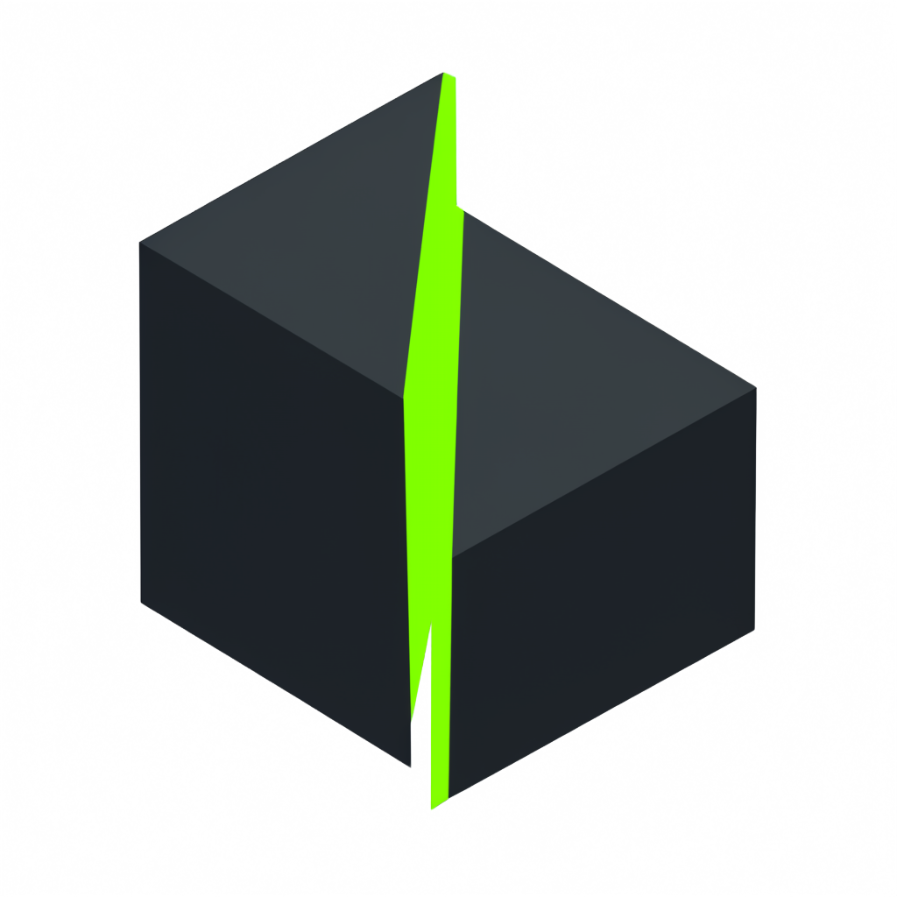

<div align="center">
  
  <summary><h1>Behead Browser</h1></summary>
  <sup>by <b>vuln.industries</b></sup>
</div>

---

<p align="center">
  Undetected, display-free headless Chromium on top of <a href="https://github.com/Kaliiiiiiiiii-Vinyzu/patchright">Patchright</a> that achieves <b>1:1 detector parity with headed Patchright</b> without Xvfb, plus optional C++ hardware/GPU rotation via the <a href="https://github.com/Vuln-Inc/behead-browser/tree/cloak"><code>cloak</code></a> branch.
</p>

---

## Overview

Even when a machine has a physical GPU, running stock Patchright in `headless: true` leaks headless signals across multiple layers:
1. **UA & Worker Client Hints:** Exposes `HeadlessChrome` in `navigator.userAgent`, `sec-ch-ua` headers, high-entropy `navigator.userAgentData` (`brands` and `fullVersionList`), and worker scopes (`Worker`, `SharedWorker`, `ServiceWorker`). Passing `--user-agent` on the CLI blanks out high-entropy Client Hints inside workers.
2. **WebGL Fallback (`SwiftShader`):** Headless Chromium defaults to software `SwiftShader` rendering (`hasSwiftShader: true`) unless hardware GPU flags are explicitly enabled and `--enable-unsafe-swiftshader` is stripped.
3. **Headless Screen / Taskbar Geometry:** Headless Chromium defaults to an `800x600` screen with `availHeight === height` (`noTaskbar: true`) and injects `--hide-scrollbars`.

**Behead Browser** fixes all three natively without Xvfb, `addInitScript` injection, or prototype tampering:
- Probes the installed Chromium binary once per process on a local loopback origin and preserves the native host OS, architecture, bitness, form factors, and browser version.
- Attaches browser-level CDP target listeners (`Target.setAutoAttach`) to apply `Emulation.setUserAgentOverride` across pages, iframes, popups, dedicated workers, shared workers, and service workers (including cached Service Workers on reopened persistent profiles).
- Enables native hardware GPU rendering (`--enable-gpu`, `--ignore-gpu-blocklist`, stripping `--enable-unsafe-swiftshader`), sets native desktop screen/taskbar geometry (`--screen-info={1920x1080 workAreaBottom=40}`, `--window-size=1920,1040`), strips `--hide-scrollbars`, and defaults to `viewport: null`.

## Branches

- **`main` (Stock Patchright Engine):** Zero-lie wrapper around stock Patchright Chromium. Achieves **exact 1:1 detector parity with Headed Patchright (`headless: false`)** on the same host (`0% headless`, `0% stealth`, `0 lies`, `hasSwiftShader: false`, `noTaskbar: false`, `0` SannySoft failures).
- **[`cloak` branch](https://github.com/Vuln-Inc/behead-browser/tree/cloak) (CloakBrowser C++ Engine over Patchright):** For GPU-less Linux VPS servers (where no physical GPU device exists) or multi-account fingerprint rotation. Drives CloakBrowser's C++-patched Chromium binary via Patchright to spoof seed-rotated hardware GPUs (`RTX 4070 SUPER`, `RTX 3070`, `RTX 3050 Ti`), CPU cores, and RAM (`fingerprintSeed`) with `fingerprintNoise: false` by default (`0 lies`, `25% likeHeadlessRating` on CreepJS, `0` SannySoft failures).

## Detector Benchmark (`bun run bench`)

`src/bench.ts` launches **Patchright (Headed Baseline)**, **Patchright (Standalone Headless)**, and **Behead Browser (Headless)** against live CreepJS, SannySoft, and Cloudflare Turnstile, and programmatically asserts 1:1 parity between `Behead Browser (Headless)` and `Patchright (Headed Baseline)`:

| Metric / Detector | Stock Playwright (Headless) | Puppeteer-Extra-Stealth (Headless) | Patchright (Standalone Headless) | CloakBrowser (Standalone Headless) | **Patchright (Headed Baseline)** | **Behead (`main` Headless)** | **Behead ([`cloak`](https://github.com/Vuln-Inc/behead-browser/tree/cloak) Headless)** |
| :--- | :--- | :--- | :--- | :--- | :--- | :--- | :--- |
| **CDP `Runtime.enable` Leak** | Leaked | Leaked | Not sent | Leaked (`playwright-core`) | **Not sent** | **Not sent** | **Not sent** |
| **CreepJS `headlessRating`** | `100%` | `38%+` | `67%` | `0%` | **`0%`** | **`0%` (1:1)** | **`0%`** |
| **CreepJS `stealthRating`** | `0%` | `40%+` (JS proxy traps) | `0%` | `0%` | **`0%`** | **`0%` (1:1)** | **`0%`** |
| **CreepJS `likeHeadlessRating`** | `69%+` | `56%+` | `50%` | `31%` (`hasVvpScreenRes`) | **`38%`** (Linux desktop baseline) | **`38%` (1:1)** | **`25%`** (Windows C++ profile) |
| **CreepJS `hasSwiftShader`** | `true` | `true` | `true` | `false` | **`false`** | **`false` (1:1)** | **`false`** (Even on GPU-less VPS) |
| **CreepJS `noTaskbar`** | `true` | `true` | `true` (`800x600`) | `false` | **`false`** | **`false` (1:1)** | **`false`** |
| **CreepJS `liesCount`** | `0` | `12+` (prototype lies) | `0` | `5` (Canvas/Audio/Rects) | **`0`** | **`0` (1:1)** | **`0`** (default) |
| **Worker High-Entropy Client Hints** | `HeadlessChrome` | Blank / Mismatched | `HeadlessChrome` | Populated | **Populated (All Workers)** | **Populated (1:1)** | **Populated (All Workers)** |
| **SannySoft Failed Checks** | `5` | `1` (`SwiftShader`) | `4` (`HeadlessChrome` + `SwiftShader`) | `0` | **`0`** | **`0` (1:1)** | **`0`** |
| **Cloudflare Turnstile (`cf_clearance`)** | Fails | Fails | Passes | Passes | **Passes** | **Passes (1:1)** | **Passes** |

## Setup

```bash
bun install
bunx patchright install chromium
bun test
bun run bench
```

## Usage

```ts
import { launchBeheadBrowser, launchPersistentBeheadSession } from "./src/index.js"

// Ephemeral session
const browser = await launchBeheadBrowser({
  proxy: { server: "http://127.0.0.1:8080" }, // optional
})
const session = await browser.newSession()
const page = await session.newPage()
await page.goto("https://example.com")
await browser.close()

// Persistent profile on disk
const persistent = await launchPersistentBeheadSession("./user-data")
const persistentPage = await persistent.newPage()
await persistent.close()
```

### GPU-less VPS & Seed Rotation (`cloak` branch)

```bash
git checkout cloak && bun install
```

```ts
import { launchBeheadBrowser } from "./src/index.js"

const browser = await launchBeheadBrowser({
  fingerprintSeed: 55123, // rotates hardware GPU, cores, and RAM (0 lies by default)
  timezone: "America/New_York",
  locale: "en-US",
})
```
